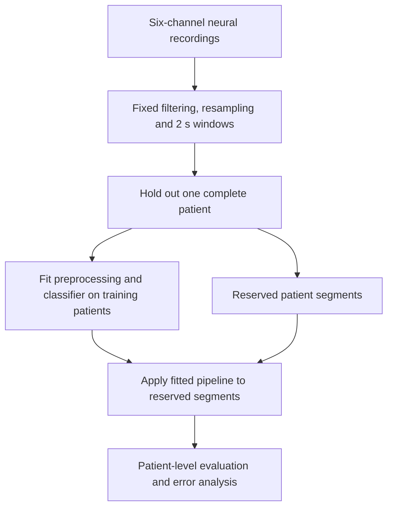
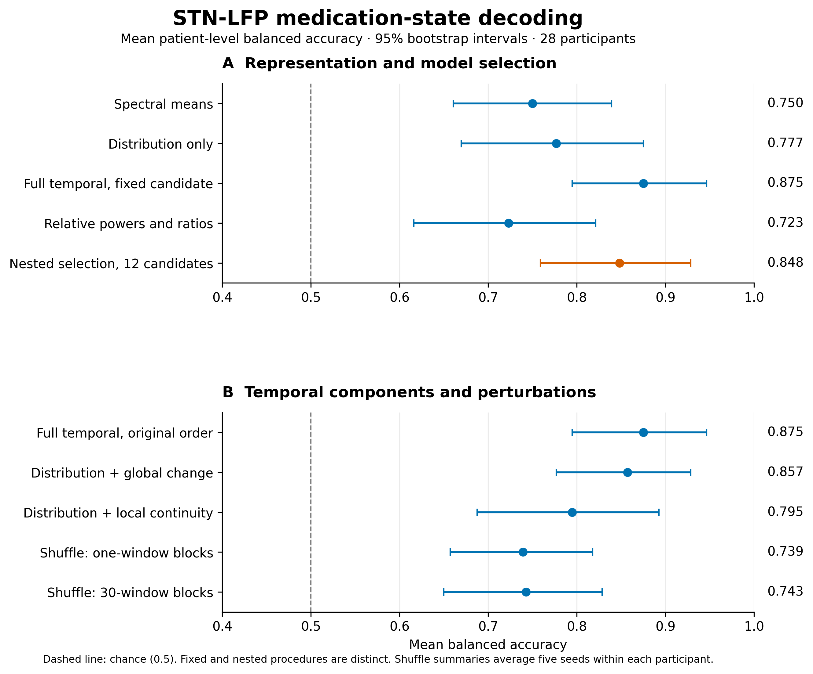

# STN-LFP medication-state decoding

Master's thesis in Biomedical Engineering, Universidad Pública de Navarra. This case study follows the final revised manuscript and its completed temporal-control analyses.

Classify medication OFF/ON states from subthalamic local field potentials in Parkinson's disease. The target is medication state, rather than diagnosis or prediction of clinical improvement.

## Signal processing and model

The evaluation includes **28 participants and 64 segments**, with 32 OFF and 32 ON segments. Six bipolar channels are filtered at 1–50 Hz, resampled to 250 Hz and divided into 2 s windows with 50% overlap.

Welch spectra produce 23 descriptors per channel: relative and log band powers, band ratios, beta-peak properties, spectral shape and entropy. The resulting 138 descriptor sequences are aggregated into a fixed-length segment representation. Nine distributional summaries and four order-dependent summaries yield **1,794 features** in the full representation.

Train-fitted processing includes robust channel scaling, removal of constant/duplicate/correlated features, imputation and standardization. The fixed classifier is Elastic Net logistic regression with `C=0.3`, `l1_ratio=0.05` and balanced class weights.



## Patient-level evaluation

There are 28 leave-one-patient-out folds. Every segment from the test participant stays outside training. Learned transformations are refitted inside each training partition.

The separate nested procedure compares four feature panels and three regularization strengths: 12 candidates. Each outer training set of 27 participants is split into three inner groups. Candidate selection uses inner held-out predictions; the selected pipeline is refitted on the 27 training participants before evaluating the outer patient.

The primary metric is mean balanced accuracy across participants. Fixed-candidate and nested-selection results are distinct procedures:

| Procedure | Mean balanced accuracy | 95% bootstrap interval |
| --- | ---: | ---: |
| Full spectral-temporal representation, fixed candidate | 0.875 | 0.795–0.946 |
| Nested selection, 12 candidates | 0.848 | 0.759–0.929 |



Intervals resample patients over held-out predictions. They are conditional on those predictions and do not repeat model training or capture the full uncertainty of model development.

## Temporal controls

- **Global change versus local continuity:** adding slope and end-to-start change gives mean balanced accuracy of 0.857; adding successive differences and lag-1 autocorrelation gives 0.795. Their direct paired contrast includes zero, so these point estimates do not establish superiority between the panels.
- **Block shuffling:** four block sizes and five seeds test temporal order while preserving within-block structure. Shuffling 30-window blocks retains 97.2% of original adjacencies but reduces mean balanced accuracy to 0.743. Seed results are averaged within participants before cohort summaries.
- **Observation budget:** the same 28 participants and 64 segments are evaluated using 10, 30 and 60 s prefixes, refitting channel normalization within each budget's training data.

| Observed prefix | Mean balanced accuracy | 95% bootstrap interval |
| --- | ---: | ---: |
| 10 s | 0.759 | 0.652–0.857 |
| 30 s | 0.571 | 0.464–0.679 |
| 60 s | 0.637 | 0.512–0.756 |

Performance is not monotonic with duration. Full recordings span 70–745 s; they are not represented as an equivalent fixed observation budget.

## Engineering and interpretation

The measured median computation time is **77.2 ms per segment**, with a 95th percentile of 122.0 ms on one CPU thread. Timing starts from already preprocessed windows and excludes acquisition and initial filtering. Computation time and required observation time are different system constraints.

The cohort informed earlier model development; even the later nested selection remains exploratory. There is no external-cohort validation. Bidirectional filtering makes the evaluation offline, including prefix experiments. Clinical-response regression did not outperform a training-mean baseline; medication-state discrimination does not establish prediction of clinical benefit.

## Inspect the results

- [Representation and selection results](stn-lfp/representation_results.csv)
- [All 36 temporal-control conditions](stn-lfp/temporal_results.csv)
- [Block-shuffle summaries](stn-lfp/block_results.csv) and [perturbation diagnostics](stn-lfp/block_diagnostics.csv)
- [Source revision and checksums](stn-lfp/provenance.json)
- [Figure-generation code](stn-lfp/render_results.py) and [vector figure](stn-lfp/results.svg)

To rebuild the figure with Python and Matplotlib, run from the repository root:

```bash
python projects/stn-lfp/render_results.py
```

Only aggregate results are published. Clinical recordings, participant identifiers and patient-level predictions remain private.
